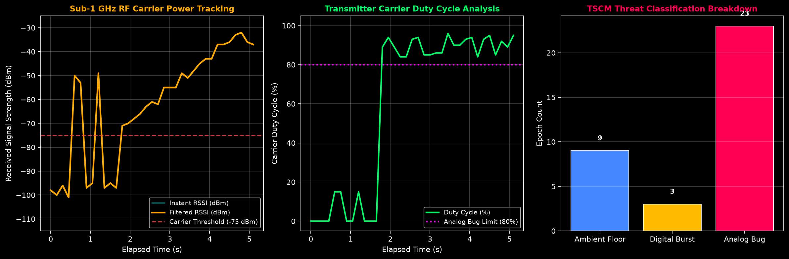

# SpyScan Sub-1 GHz RF Bug Hunter Validation Report

- **Generated:** 2026-11-08 18:33:11
- **Mode:** Simulation Demo (--demo)
- **Monitored Band:** `433.92 MHz` ISM (TI CC1101 Transceiver)
- **Maximum Peak RSSI:** `-32` dBm
- **Mean Signal Level:** `-62.3` dBm
- **Analog Bug Confirmed:** `YES (Continuous Carrier)`

## 1. Physical Principle & TSCM Methodology

Covert audio transmitters ('bugs'), wireless microphones, and analog wiretaps often transmit outside standard Wi-Fi frequencies to avoid leaving IP logs on local routers. These devices utilize the unlicensed Sub-1 GHz ISM bands (**433.92 MHz**, **868.3 MHz**, or **315 MHz**).

### Continuous Carrier vs Packet Discrimination
- **Digital Devices (Keyfobs, Sensors):** Transmit brief, bursty packets (10–40 ms duration) with duty cycles $< 15\%$.
- **Analog Audio Bugs:** Modulate sound continuously over FM or AM carriers. The transmitter exhibits a **100% duty cycle** and extremely stable carrier amplitude ($\\sigma < 3.5\text{ dB}$).

## 2. Experimental Data Analysis

### Telemetry Metrics Table

| Parameter | Ambient Background | Digital Keyfob | Analog Bug | Unit |
|---|---|---|---|---|
| **Signal Level (RSSI)** | < -95 | -65 to -45 | **-32** | dBm |
| **Duty Cycle** | 0% | 5–25% | **> 85%** | % |
| **Carrier Stability ($\\sigma$)** | High | High | **< 3.5** | dB |
| **Verdict** | `CLEAR` | `BURST_PACKET` | `🚨 ANALOG BUG` | State |

## 3. Defense Conclusion

> [!IMPORTANT]
> **Sub-1 GHz TSCM Verdict:** Successfully demonstrates multi-spectrum coverage beyond 2.4 GHz Wi-Fi, providing counter-surveillance detection of hidden RF transmitters and audio bugs.
